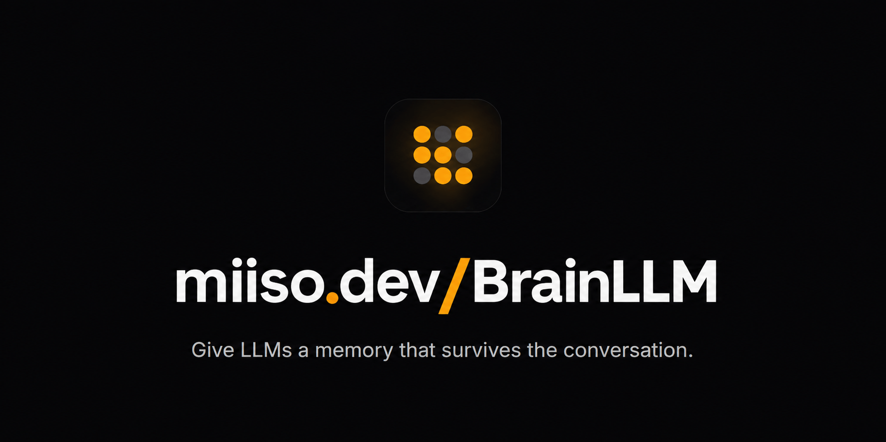

<div align="center">

# BrainLLM



**Give Claude a memory that survives the session.**

[](https://github.com/miisodev/BrainLLM/releases)
[](https://github.com/miisodev/BrainLLM/actions/workflows/ci.yml)
[](https://www.npmjs.com/package/brainllm)
[](./LICENSE)
[](https://bun.sh)
[](https://modelcontextprotocol.io)

[](https://mcprush.com/to/brainllm-mcp?ref=badge)

[Site](https://miiso.dev/brainllm) · [Connect to Claude](docs/CONNECT.md) · [How it works](#how-it-works) · [Quick start](#quick-start) · [Privacy](PRIVACY.md)

</div>

---

## Sponsorship

BrainLLM is built and maintained by one person, and it's free. If it earns a place in your work, please consider sponsoring it. Sponsorship pays for the hours that keep it current with Trilium, the MCP specification and the clients that connect to it.

<div align="center">

[](https://github.com/sponsors/miisodev)
[](https://paypal.me/miisodev?locale.x=en_US&country.x=ZA)

</div>

**What sponsors get:** a copy of the **architecture reference**, the from-source guide to every module, the tool behaviour, the content pipeline, the session gate, the lifecycle sweeps, deployment and the OAuth server. It isn't published in this repository and is kept current with each release. Ask for it through GitHub Sponsors or by email.

Starring the repository and telling one person who'd use it help too.

---

## What it is

LLMs forget. Every session starts from zero: who you are, what you're building, what was decided yesterday, what went wrong last week. You end up re-explaining your own life to a collaborator who was there.

**BrainLLM is the memory that fixes that.** It's an MCP server that gives the model a real, persistent memory inside [TriliumNext Notes](https://github.com/TriliumNext/Trilium), the open-source knowledge base you host yourself. The model opens each session by loading who you are and what's live, writes durable facts the moment they surface, links what it learns into a typed graph, and closes each session with a log, a diary entry and a database backup. The next session picks up where the last one ended.

Every memory is an ordinary note you can open, read and correct by hand. Correct one, and the model reads your correction next session. Nothing is hidden in an embedding store or a vendor's account, and if this project disappeared tomorrow, your brain would still open and still make sense.

> **The model supplies content. The server owns form.**

Placement, labels, deduplication, dates, relations, lifecycle and backups are server policy, enforced at the tool layer. A rule the model is asked to follow holds until the model has a bad day. A rule the server enforces holds.

## What it's for

BrainLLM is for people who run an LLM as a long-running collaborator, not a one-shot answer box.

| You want the model to... | BrainLLM gives it |
|---|---|
| **Know you without being told again** | Your biography, goals and preferences, loaded in full at the start of every session |
| **Carry work across days** | Threads, one per line of work, with a dated entry for every day it moved and a resolution when it's done |
| **Keep what it learned** | Knowledge domains where each claim traces to a source, plus a Current State note for what was last measured |
| **Admit what changed** | A daily change log, a review of every note a session touched, and checks that catch notes disagreeing with each other |
| **Not lose the session** | A close gate that refuses to end a session until it has been logged, reflected on and backed up |
| **Work in every client** | One memory for Claude Code, Claude Desktop, claude.ai, Cowork, Claude mobile, Cursor and any other MCP client |

It's a fit if you're comfortable hosting one small service and a Trilium instance. That's real setup, and it's why your data stays yours.

---

## How it's made

### Where it came from

BrainLLM began in February 2026 as a personal experiment by [Kevin Miiso Novo](https://github.com/miisodev): could an LLM run a real, self-hosted memory well enough to be trusted with it, orienting, writing, connecting and closing sessions without a human doing the filing? It became the memory behind his own ventures, used every day by Claude and the other models that work with him. Months of that daily use found the failure modes and shaped the fixes. What's in this repository is the same code, not a demo.

### What it's built on

| Layer | Choice | Why |
|---|---|---|
| Storage, editor and human interface | [TriliumNext Notes](https://github.com/TriliumNext/Trilium), reached only through its public ETAPI | A mature note application you already know how to back up, read and edit. BrainLLM never touches Trilium's internals, which is also what lets an MIT server sit beside AGPL Trilium |
| Server | One Bun process in TypeScript | Two runtime dependencies: the [MCP TypeScript SDK](https://github.com/modelcontextprotocol/typescript-sdk) and [Zod](https://zod.dev) |
| Protocol | [Model Context Protocol](https://modelcontextprotocol.io) over stdio, Streamable HTTP and legacy SSE | One memory, every client |
| Remote auth | A built-in OAuth 2.1 authorization server (CIMD and RFC 7591 registration), plus a static bearer token | Hosted Claude surfaces offer OAuth or nothing, and an external identity provider would put a third-party sign-up in front of every self-hoster |
| Retrieval | Trilium's search plus the server's structure: areas, domains, labels and typed links | No model runs inside BrainLLM and no embeddings are computed |

### The architecture

```
index.ts ─┬→ tools.ts ─┬→ trilium.ts     ETAPI client: bounded, retrying I/O and graph traversal
          │            ├→ router.ts      placement policy: kind → parent, label plans, domains
          │            ├→ templates.ts   the canonical structure of every kind
          │            ├→ normalize.ts   titles, slugs, markdown → HTML, sanitising, section surgery
          │            ├→ elements.ts    the element (row, item, paragraph) an anchor sits in
          │            ├→ diffing.ts     block and table-cell diffs, revision selection
          │            ├→ lifecycle.ts   protection, the sweeps, aging, the start digest
          │            ├→ journal.ts     daily Insights logs, regenerated in place
          │            ├→ seal.ts        per-day record seals that maintain(deep) verifies
          │            ├→ bootstrap.ts   the five-area tree builder
          │            └→ tools-{master,llm,memory,knowledge,insights}.ts → tools-surface.ts
          ├→ tools-advanced.ts                             full-mode raw ETAPI
          ├→ serialize.ts · coerce.ts · annotations.ts     the write lock, parameter coercion, permission hints and titles
          ├→ cap.ts · brand.ts · config.ts                 the result cap · name, mark and instructions · brainllm.json
          ├→ HTTP: sse.ts · rate-limit.ts · operability.ts legacy SSE · request budgets · readiness, logs and drain
          └→ OAuth: oauth.ts · totp.ts                     the OAuth 2.1 server (CIMD checks in network-security.ts) · the optional owner TOTP
```

`types.ts` defines every vocabulary once (areas, kinds, statuses, relations, policy defaults), `time.ts` handles local dates and `icons.ts` supplies note icons. `init.ts` is the separate bootstrap CLI. The tool schemas, the router and the tree builder all derive from `types.ts`, so a vocabulary can't drift between them.

### The engineering decisions

- **Structure is enforced, not requested.** Every kind of note has a canonical skeleton (`template(kind)`), held on write. A new thread needs its goal. Records open with an identification line naming the model, the environment and the run. Duplicate headings, unbalanced tags and table rows that disagree with their header are caught at write time and by the deep sweep.
- **Timeless notes, dated records.** Knowledge and thread books hold no state or history. Measured state lives in each domain's Current State note, and history lives in the records, where the date is native. The deep sweep flags dated prose that creeps into a timeless note.
- **Records you can prove.** Sessions, diary entries and dated thread entries are append-only. Every `close()` seals its day's records into a digest chained to the previous day's, and `maintain(deep)` reports any sealed record that was rewritten afterwards.
- **Every edit can be checked first.** A revision snapshot precedes every routine content overwrite, and a failed snapshot stops the write. `revise(..., dryRun=true)` previews a change with no write and no revision. `diff(since="today")` reviews every note a session changed.
- **Safe for more than one agent.** Every write-classified tool runs behind one process-wide FIFO lock, so an interactive session and an automated run writing through one hosted instance queue in arrival order. Reads stay parallel.
- **Resilient plumbing.** Every Trilium call is time-bounded, idempotent reads retry once, and writes never retry because Trilium doesn't deduplicate them. Core writes are idempotent or duplicate-guarded, and content surgery survives the editor's own HTML rewriting.
- **Bounded results.** No tool result exceeds 140,000 characters. A larger one is cut with a note naming the narrower read to make instead.
- **Honest operations.** `/health` is liveness and `/ready` is readiness against Trilium. Logs are allowlisted metadata only: no note content, tool arguments or results, URLs, note ids or tokens. HTTP mode drains in-flight work on shutdown and fails closed without a credential.
- **Its own identity in your client.** Hosted instances serve same-origin icons and advertise BrainLLM's name, description and session shape in the MCP handshake, so the connector shows its own mark rather than your domain's.
- **Privacy by construction.** No analytics, telemetry or hosted account. Notes live in your Trilium and sign-in records stay on your server. Tool results do reach your MCP client and its model provider, under their own policies. The [privacy policy](PRIVACY.md) says what's stored where.

---

## How it works

### 1. The brain has five areas

`bootstrap()` builds this tree in your Trilium. Every note the tools create is typed, labelled, dated and placed by the server.

```
BrainLLM  (#brainLlmRoot)
├── Master       Biography · Goals · Preferences                      who you are
├── LLM          Responsibilities · Protocols · Self-correction · Diary   who the model is here, and its daily diary
├── Memory       Sessions · Threads                                    what happened, day by day and line by line
├── Knowledge    Master · Domains/<domain>/{Sources, information}       what was learned, with its sources
└── Insights     Logs · Graph · Claims                                 the brain's record of itself
```

| Note class | Kinds | Behaviour |
|---|---|---|
| **Singletons** | biography, goals, preferences, responsibilities, protocols, self-correction, and each domain's Sources | One maintained note each, edited in place |
| **Records** | session, diary, dated thread entry | One per day and parent. Every write lands as a timestamped block, never a rewrite |
| **Collections** | thread, user knowledge, domain, information | Titled notes, deduplicated by title within their scope |
| **Generated logs** | log | One per day, regenerated in place from what changed |

A thread takes one of two shapes, chosen at creation: **dated**, with one entry per day it moved, or **collection**, with one maintained entry per item, like an ideas list.

### 2. A session has a shape the server enforces

```
start()                          load who you are, what's live and what changed since last time
  [day()]                        on the first session of a day: yesterday's session and everything touched since
  remember · revise · recall     work, writing durable facts the moment they surface
session() → addendum() → maintain() → remarks() → diary() → close()
```

`close()` refuses until those steps actually ran, and until the last `session()`, `remarks()` and `diary()` happened in that order. A model saying it did the steps doesn't count; only tool calls do. The gate is written to the session note, so it survives a restart and behaves the same over stdio and HTTP. A session that wrote nothing gets a light close: `session()`, `remarks()`, a short `diary()` and `close()`.

`close()` then writes the session log, regenerates the day's change log, seals the day's records and triggers a Trilium backup into a rolling weekday slot.

### 3. Knowledge is a typed graph

Notes link through a closed vocabulary of 16 relations: `extends`, `contradicts`, `supports`, `partOf`, `supersedes`, `corrects` and ten more. `connect()` wires them, `explore()` walks links, backlinks, neighbourhoods and shortest paths, and `graph()` renders the whole graph, or one note's neighbourhood, as a Mermaid diagram in a native Trilium note.

### 4. The brain checks itself

| Check | What it answers |
|---|---|
| `maintain(deep=true)` | What's drifted: orphans, stale notes, duplicate titles, oversized notes, dated prose in timeless notes, broken table shapes, unverified sources, rewritten sealed records |
| `consistency(pattern \| subject)` | Does the brain agree with itself? Every note asserting a fact, grouped by value, with coverage that says whether the scan was complete |
| `claim(...)` | Does the brain still agree with the world? An assertion and its check, re-verified with evidence |
| `diff(since="today")` | What did this session actually change? |

A finding you've reviewed and judged correct can be acknowledged, and it stays quiet until that note's content changes.

### 5. The tools read like what they do

Most MCP clients show each tool call as it happens, so BrainLLM names its tools as plain verbs for what's happening to your memory. The call log reads as a description of the session.

| You see | What it means |
|---|---|
| `start` → `day` | Orienting: loading who you are, what's open, what changed |
| `remember` · `diary` | Writing something down: a durable fact, or the model's own daily record |
| `recall` · `domain` · `outline` | Looking something up before answering, rather than answering from training |
| `revise` · `resolve` · `forget` | Changing, completing or archiving something that already existed |
| `connect` · `graph` | Wiring a relationship between two things |
| `maintain` · `addendum` | Housekeeping: aging, drift, folding pending edits in |
| `remarks` → `close` | Wrapping up: reflecting, then committing the session log |

**Core mode** serves 45 tools: 35 verbs and 10 surface reads (`master`, `llm`, `memory`, `knowledge`, `insights`, each with a `_recall` skim). **Full mode** (`BRAINLLM_MODE=full`) adds 33 raw Trilium primitives, deliberately named after Trilium (`create_note`, `patch_note`) so a guard-free operation is visibly different in the log.

Every tool declares whether it reads, writes or destroys, so your client can grant permission by group. Core mode splits **23 read-only · 17 write · 5 destructive**; full mode splits **34 · 31 · 13**. `revise`, `label` and `connect` count as destructive because they can overwrite or remove. The classification lives in one table, [`src/annotations.ts`](./src/annotations.ts), and a tool missing from it is treated as a write.

The model learns the protocol from the **operational skill** in [`skills/brainllm/`](./skills/brainllm/SKILL.md), with per-topic references beside it.

---

## Quick start

### What you need

- [Bun](https://bun.sh) 1.4.2 or later
- A running [TriliumNext](https://github.com/TriliumNext/Trilium) instance, desktop or server
- An MCP client

### 1. Get an ETAPI token

In Trilium, open **Options → ETAPI → Create token**. Or let BrainLLM mint one: set `TRILIUM_PASSWORD` in place of `TRILIUM_ETAPI_TOKEN` and it creates a token on first start and caches it beside `brainllm.json`, so restarts reuse it. That's the easiest path for a container, where there's no terminal to run setup in.

### 2. Connect your client

**Claude Code**, running BrainLLM locally from npm:

```bash
claude mcp add brainllm -e TRILIUM_BASE_URL=http://localhost:8080 -e TRILIUM_ETAPI_TOKEN=your-token -- npx -y brainllm
```

**Claude Desktop**, in `claude_desktop_config.json` (`%APPDATA%\Claude\` on Windows, `~/Library/Application Support/Claude/` on macOS, `~/.config/Claude/` on Linux):

```json
{
  "mcpServers": {
    "BrainLLM": {
      "command": "npx",
      "args": ["-y", "brainllm"],
      "env": {
        "TRILIUM_BASE_URL": "http://localhost:8080",
        "TRILIUM_ETAPI_TOKEN": "your-etapi-token"
      }
    }
  }
}
```

**claude.ai, Claude mobile and Cowork** connect only to a hosted server over OAuth. See [Run it remotely](#run-it-remotely), then follow [`docs/CONNECT.md`](docs/CONNECT.md).

The npm package runs on Bun, so Bun must be on your `PATH` (and Node.js, for `npx`). A schema-valid MCPB manifest (`manifest.json`) is included for hosts that support a custom Bun command; no one-click `.mcpb` file is published.

### 3. Bootstrap the brain

Restart your client and ask the model to run `bootstrap`. It builds the five-area tree, engraves each area with its purpose and writes `brainllm.json`. It adopts an existing brain rather than building a second one.

### 4. Teach the model to operate it

Install the operational skill, which teaches the model to treat BrainLLM as its own memory rather than a filing cabinet:

```bash
git clone https://github.com/miisodev/BrainLLM
cp -r BrainLLM/skills/brainllm ~/.claude/skills/brainllm
```

```powershell
git clone https://github.com/miisodev/BrainLLM
Copy-Item BrainLLM\skills\brainllm "$env:USERPROFILE\.claude\skills\brainllm" -Recurse -Force
```

For clients that take a skill upload, such as claude.ai, use `brainllm.zip` from the [latest release](https://github.com/miisodev/BrainLLM/releases/latest): it's the same folder, zipped.

Then start a session. The model calls `start()`, orients, and works from there.

### Run it remotely

The included [`Dockerfile`](./Dockerfile) builds the HTTP connector: two stages, a digest-pinned `oven/bun` image, and privileges dropped at start. Setting `PORT` selects HTTP mode, which serves:

| Route | Purpose |
|---|---|
| `/mcp` | Streamable HTTP MCP, one session per `mcp-session-id`. MCP requests sent to `/` take the same path, for clients that post to the root after OAuth |
| `/sse` + `POST /messages` | Legacy SSE for clients that predate Streamable HTTP |
| `/health` · `/ready` | Liveness, and readiness against Trilium |
| OAuth and icon routes | Discovery, consent, token exchange and same-origin icons |

**On Railway**, `PORT` is injected. Set `MCP_AUTH_TOKEN`, `TRILIUM_BASE_URL`, `TRILIUM_ETAPI_TOKEN` and `BRAINLLM_TZ`, deploy, and point your client at `https://<app>.up.railway.app/mcp`. Anywhere else, the container needs the same variables and a TLS-terminating proxy in front (Caddy, nginx or a Cloudflare Tunnel), because the server speaks plain HTTP.

**HTTP mode fails closed.** It refuses to start without `MCP_AUTH_TOKEN` or `BRAINLLM_OWNER_PASSWORD`. `BRAINLLM_ALLOW_UNAUTHENTICATED_HTTP=true` exists only for an isolated, trusted network.

**For claude.ai, Claude mobile and Cowork**, set `BRAINLLM_OWNER_PASSWORD`. That turns on the built-in OAuth 2.1 server, and the password is what you type on the consent screen. In Claude, open **Settings → Connectors → Add custom connector**, enter `https://<your-host>/mcp` and leave the client fields blank. Claude discovers the rest, you approve once, and it stays connected. A static token from Claude Code and an OAuth token from claude.ai work against the same brain at the same time.

**Keep tokens across redeploys** by mounting a volume on the BrainLLM service (not the Trilium service) and pointing `BRAINLLM_CONFIG` at a file inside it. The OAuth signing secret and refresh tokens persist beside that file:

```bash
railway volume -p <project-id> -s <brainllm-service-id> -e production add --mount-path /vol
railway variables set BRAINLLM_CONFIG=/vol/brainllm.json
```

Without a volume, leave `BRAINLLM_CONFIG` unset: auto-discovery finds the brain from Trilium's `#brainLlmRoot` label on each cold start.

<details>
<summary><strong>OAuth endpoints, owner second factor and browser origins</strong></summary>

| Endpoint | Purpose |
|---|---|
| `/.well-known/oauth-protected-resource` (+ `/mcp` variant) | RFC 9728: names the authorization server |
| `/.well-known/oauth-authorization-server` (+ `/mcp` variant) | RFC 8414: advertises CIMD, DCR and PKCE S256 |
| `/authorize` | Validates the client (CIMD document or registered id) and shows the consent screen |
| `/token` | PKCE-verified code exchange, with rotating refresh tokens stored only as SHA-256 hashes |
| `/register` | RFC 7591 dynamic client registration, for DCR-only clients such as opencode |

The consent screen names the requesting client and its return address, and warns when that address is your own computer. Access tokens are signed JWTs bound to your server's resource URI, so a token minted for another MCP server is refused. MCP traffic is rate-limited per bearer token with a looser per-IP bound, because hosted clients share an egress range.

**Owner second factor.** Set `BRAINLLM_OWNER_TOTP_SECRET` to require a six-digit authenticator code with the owner password: RFC 6238, HMAC-SHA1, 30-second steps, one step of tolerance. The secret is base32 of at least 128 bits, and the owner password must then be at least 16 characters. A configured but invalid secret fails closed with a 503, never falling back to password-only. **Enrol before enabling:** add the secret to your authenticator, confirm it shows a code, keep an offline copy of the seed, then set the variable and redeploy. A used code can't be replayed, the seed itself is never stored, and existing tokens keep working. If the authenticator is lost, restore the seed, or have a deployment admin remove the variable and redeploy. There's no in-app bypass.

**Browser origins.** A browser MCP call must carry an allowed `Origin`: the `BRAINLLM_PUBLIC_URL` origin, a literal loopback origin at the listening port, or an exact entry in `BRAINLLM_ALLOWED_ORIGINS`. Wildcard, `null` and malformed origins get a 403. Native clients send no `Origin` and are unaffected.

**Limits.** CORS defaults to `*`, so a reachable deployment needs a real authentication gate. Idle MCP sessions are evicted after an hour, and request bodies are capped at 50 MiB.

**Damaged OAuth state.** If the OAuth store is unreadable or its replay state is corrupt, new MFA grants fail closed across restarts. Keep the damaged file for diagnosis and restore a verified backup of the store, or reset it deliberately after rotating `BRAINLLM_OAUTH_SECRET` and arranging for clients to reconnect. Don't repeatedly delete state to get past an unexplained error.

**Readiness.** `/ready` calls Trilium's `app-info`, caches success for 10 seconds and failure for 5, and bounds each check at 3 seconds. Unexpected server errors and failed tool results hold it unavailable for 30 minutes, so an external probe can alert even while Trilium is reachable. On `SIGTERM` or `SIGINT`, HTTP mode reports `draining`, finishes in-flight work for up to 20 seconds and exits 0.

</details>

<details>
<summary><strong>Configuration reference</strong></summary>

| Variable | Required | Purpose |
|---|---|---|
| `TRILIUM_BASE_URL` | ✅ | The TriliumNext instance: local, or an HTTPS proxy or tunnel URL |
| `TRILIUM_ETAPI_TOKEN` | ◐ | ETAPI bearer token. Required unless `TRILIUM_PASSWORD` is set |
| `TRILIUM_PASSWORD` | ◐ | Mints a token on first start and caches it beside `brainllm.json`. Also used by `bun run init` |
| `BRAINLLM_MODE` | - | `core` (default) or `full` (adds the raw ETAPI tools) |
| `BRAINLLM_TZ` | - | IANA timezone, such as `Africa/Johannesburg`, so dates stamp in your day on a hosted deploy. Unset uses the host clock |
| `BRAINLLM_DELETION_CATCHUP_DAYS` | - | How long your Trilium keeps deleted notes (Options → Other → "Erase notes after"). ETAPI can't read it. Default `7` |
| `PORT` | - | Its presence selects HTTP mode |
| `MCP_AUTH_TOKEN` | - | Static bearer token on `/mcp`, sent by Claude Code and `mcp-remote` |
| `BRAINLLM_OWNER_PASSWORD` | - | Turns on OAuth 2.1, required for claude.ai. Typed on the consent screen |
| `BRAINLLM_OWNER_TOTP_SECRET` | - | Optional owner second factor. Needs a 16+ character owner password. Enrol before enabling |
| `BRAINLLM_OAUTH_SECRET` | - | Optional 32+ character signing secret. Rotate it to invalidate old OAuth tokens |
| `BRAINLLM_PUBLIC_URL` | - | Public origin when a proxy rewrites `Host`. Must match the URL you enter in the client exactly |
| `BRAINLLM_TRUST_PROXY` | `false` | Trust `x-forwarded-host` and `x-forwarded-proto` for OAuth discovery, only behind a trusted proxy |
| `BRAINLLM_ALLOWED_ORIGINS` | - | Extra exact HTTP(S) origins for browser MCP clients, comma-separated |
| `BRAINLLM_ALLOW_UNAUTHENTICATED_HTTP` | `false` | Trusted-network-only escape hatch. Never on a public interface |
| `BRAINLLM_CONFIG` | - | Absolute path for `brainllm.json` on a persistent volume |

Lifecycle timings live in `brainllm.json` and are yours to tune. Threads age `active → dormant → archived in place`. Nothing is deleted by aging, and `recover()` and `withdraw()` bring anything back.

```json
"policy": { "dormantAfterDays": 21, "archiveDormantAfterDays": 45, "staleAfterDays": 7 }
```

</details>

### Develop it

```bash
git clone https://github.com/miisodev/BrainLLM
cd BrainLLM
bun install
bun run dev                  # hot-reload dev server
bun run build                # bundle to dist/index.js
bunx --bun tsc --noEmit      # typecheck (the bundler doesn't)
bun run test:unit            # every unit suite
bun run test:http            # local auth and header smoke, no Trilium needed
bun run test                 # integration tests against a live Trilium
bun run validate:manifest    # MCPB schema and icons
bun run validate:release     # every version site, server.json and SECURITY.md
bun run init                 # bootstrap from the command line
```

Runtime source is in `src/`, the operational skill in `skills/brainllm/`, developer scripts in `scripts/`.

**Verify a published package.** Install the exact version in a disposable directory with `npm install --ignore-scripts brainllm@<version>`, then run `npm audit signatures`. Check the package's provenance names the repository `miisodev/BrainLLM`, the workflow `.github/workflows/publish.yml` and the tag `refs/tags/v<version>`. That proves where the package came from, not that the code is safe. See [npm's provenance guidance](https://docs.npmjs.com/generating-provenance-statements/).

---

## Contributing

BrainLLM is open source as a gift and maintained by its author in his own design. **Forks are welcome; pull requests are not accepted.** Issues are read, and they shape what gets built next.

**What we want:**

| | |
|---|---|
| **Bug reports** | What you ran, what you expected, what happened, and your client, transport and Trilium version |
| **Generalising it** | Anything in the tool layer that assumes one person's workflow, vocabulary or schedule. That belongs in the content the model writes, never in `src/` |
| **Cross-platform gaps** | Behaviour that differs between Windows, macOS and Linux, between stdio and HTTP, or between a laptop and a container |
| **Leaner reads** | Smaller responses, fewer round trips, a faster `start()`. Every result is paid for in the model's context |
| **Doc gaps** | Anything in this README, [`docs/CONNECT.md`](docs/CONNECT.md) or the skill that's wrong, missing or hard to follow |

**How to contribute:**

1. **Open an [issue](https://github.com/miisodev/BrainLLM/issues)** with the reproduction or the use case spelled out.
2. **Fork it** to build your own version. Port what you like: it's MIT.
3. **Report vulnerabilities privately**, never in a public issue, through the process in [`SECURITY.md`](./SECURITY.md). Leave ETAPI tokens, OAuth credentials and brain content out of every report.

---

## Support

BrainLLM is made by [Kevin Miiso Novo](https://miiso.dev). Reach him on any of these.

<div align="center">

[](https://miiso.dev)
[](https://x.com/miisodev)
[](https://contra.com/miisodev)
[](https://github.com/miisodev)
[](mailto:miisodev@gmail.com)

</div>

| Reach out for | Where |
|---|---|
| **Help setting it up.** Miiso will help you get BrainLLM running: your Trilium, your host and your clients. Say what you use and where you want it to live | [Email](mailto:miisodev@gmail.com) |
| A bug or a question about how something works | [GitHub issues](https://github.com/miisodev/BrainLLM/issues) |
| A security concern | [`SECURITY.md`](./SECURITY.md), privately |
| The architecture reference, as a sponsor | [GitHub Sponsors](https://github.com/sponsors/miisodev) or [email](mailto:miisodev@gmail.com) |
| Building something on top of it, or custom work | [Contra](https://contra.com/miisodev) or [email](mailto:miisodev@gmail.com) |
| Following what ships next | [X](https://x.com/miisodev) and [miiso.dev/brainllm](https://miiso.dev/brainllm) |

---

## Licence

[MIT](./LICENSE) © [Kevin Miiso Novo](https://github.com/miisodev)

**Credits**

- [TriliumNext Notes](https://github.com/TriliumNext/Trilium), the open-source, self-hosted knowledge base BrainLLM stands on. It wouldn't exist without the TriliumNext team's work.
- The [Model Context Protocol](https://modelcontextprotocol.io) and its [TypeScript SDK](https://github.com/modelcontextprotocol/typescript-sdk), which let one memory serve every client, and [Zod](https://zod.dev) and [Bun](https://bun.sh), which the server runs on.
- Claude, which uses BrainLLM every day on Miiso's projects and wrote this README with him.
